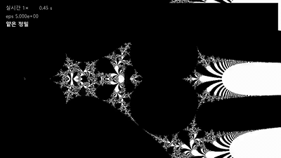

# mytetration — CUDA 가속 · 실시간 뷰어



처음 화면 (0, 0, 5) 에서 m37 위치의 eps 1e-40 까지 들어가는 녹화입니다. 실제 113.2 초를 12.6 초로 줄였고, 위 띠의 시간은 원본 녹화의 경과 시간입니다.

> 원본: [DMTPARK/mytetration](https://github.com/DMTPARK/mytetration)
> 이 포크는 원본 파일 가운데 `README.md` 말고는 아무것도 바꾸지 않았습니다. `README_CUDA.md` 와 `cuda/` 폴더를 새로 더했고, `README.md` 에는 맨 위에 이 절만 덧붙였습니다. 원본 README 는 이 절 아래에 그대로 이어집니다.

## 이 포크에서 달라진 점

### 1. CUDA 로 같은 그림을 빠르게
원본 코드(`compute_tetration_divergence`)와 같은 계산을 NVIDIA GPU 에서 돌립니다. 정밀도는 원본과 같은 float64 입니다.

| 장면 | 원본(CPU, NumPy) | CUDA |
|---|---|---|
| 기본 화면 (1by1_H, n=500) | 72.89 s | 0.0276 s |
| 확대 화면 (1by1_H, n=500, x0 −0.43138, y0 0.895038, eps 0.1) | 102.12 s | 0.0409 s |
| 기본 화면 4K (n=3840) | 4,338.6 s (추정) | 1.3971 s |

- 측정 조건: RTX 3090 Ti · Windows 11 · Python 3.12 · NumPy 2.5.4. 원본은 2회 중 두 번째 값, CUDA 는 4회 중 첫 회를 버린 중앙값(맵 전체가 메모리에 올 때까지). 4K 원본은 120행만 계산해 전체 행 수로 환산한 추정값입니다.
- 원본과 다른 픽셀은 13개 세트 합계 1,306개이고, 모두 판정이 반올림 경계에 걸린 픽셀임을 한 걸음씩 원본 연산과 비교해 확인했습니다.

### 2. 실시간 뷰어
마우스로 끌어 옮기고 휠로 확대·축소하면 1080p 그림이 바로 따라옵니다.
- 움직이는 동안 **62.5–62.9 fps**. (측정 조건: 뷰어 첫 판(조작 중 늘 float32, 화면마다 고르는 정밀도·하이브리드 표시·깊은 확대를 더하기 전)에서 D1·Z1 장면으로 잰 값이고 지금 판으로 다시 재지는 않았습니다. 1920×1080 계산 + 960×540 창, 10초 대본 입력 628개 = 초당 62.8개를 그대로 재생한 값이라 fps 가 입력 속도에 묶여 있습니다. 계산만 보면 한 장에 약 7 ms.)
- 손을 떼면 원본과 같은 정밀(double) 그림으로 바뀌기까지 **0.450–0.570 s**. (측정 조건: 같은 뷰어 첫 판, 마지막 입력부터 정밀 그림이 화면에 나올 때까지, 멈춤 판정 0.25 s 포함, 두 장면 × 3회.)

### 3. 1e-40 까지 깊은 확대
원본 README 의 «확대 한계» 에 «`eps` 가 10<sup>-13</sup> 을 넘어가면서 픽셀화되고 … 아직 정확한 원인을 파악하지는 못했으나» 라고 적혀 있었는데, 그 원인과 해결을 정리했습니다.
- **원인**: 파이썬 float 는 배정밀도(유효숫자 약 16자리)입니다. 화면 중심이 −0.43 같은 값이고 `eps` 가 10<sup>-13</sup> 쯤이면, 이웃한 픽셀 사이의 좌표 차이가 그 숫자로 나타낼 수 있는 가장 작은 차이와 비슷해집니다. 그러면 여러 픽셀이 같은 좌표가 되어 같은 색을 받고, 그림이 네모 블록으로 뭉개집니다. NumPy 만의 문제가 아니라 배정밀도 숫자의 한계입니다.
- **해결 (섭동 방식)**: 화면 중심 근처 한 점의 궤도만 아주 높은 정밀도(mpmath)로 계산하고, 나머지 픽셀은 그 점과의 «작은 차이» 만 배정밀도로 따라갑니다. 차이는 작은 숫자라 배정밀도로도 충분합니다. 화면 중심 좌표는 긴 문자열로 들고 다녀서, 끌기·휠을 아무리 해도 반올림이 쌓이지 않습니다.
- **결과**: eps **1e-40** 까지 들어갈 수 있습니다. 1e-40 에서 새 정밀 그림 한 장은 **485.6–622.8 ms** 입니다. (측정 조건: 무늬 있는 위치 4곳, 1920×1080, 반복 1040회, 5회 중 첫 회를 버린 중앙값, 기준 궤도 계산 포함.)
- **정답과 비교**: 고정밀로 직접 계산한 정답과 비교한 불일치율은 최대 0.16 % (625 표본) · 0.20 % (균일 2,000 표본) · 0.40 % (경계 근처 5,000 표본) 입니다. (측정 조건: 위치 4곳 × 깊이 6개.)

### 4. 숫자키로 무늬 위치 바로 가기
깊이 들어가도 무늬가 끝까지 이어지는 위치 4곳을 찾아 숫자키에 넣었습니다.
- `1` m37 · `2` m191 · `3` m59 · `4` m60b: 각 위치의 eps 1e-15 화면으로 바로 갑니다. 거기서 휠로 1e-40 까지 들어가 보세요.
- `0`: 처음 전체 화면(0, 0, 5)으로 돌아갑니다.

### 5. 계단 없는 반복 횟수와 깊이 표시(HUD)
- 깊이 들어갈수록 반복 횟수(`max_iter`)를 늘립니다: eps ≥ 1e-13 에서는 500, 그 아래는 500 + round(20·log10(1e-13/eps)). 휠 한 칸에 0 또는 1씩만 오르고, 1e-40 에서 1040 입니다.
- 예전처럼 10배마다 20씩 한꺼번에 뛰면 그 자리에서 무늬가 갑자기 생겼습니다. 무작위 확대 경로 4개에서 휠 한 칸에 바뀌는 화면 비율은 경로별 최대 0.0276–0.0696 % 입니다(예전 규칙 0.454–1.007 %). (측정 조건: 처음 화면 (0, 0, 5) 에서 시작한 씨앗 0–3 의 무작위 경로, 경로당 453칸.)
- 창 오른쪽 위 한 줄(HUD)에 지금 깊이가 늘 보입니다. 예: «m37 · 이동함 · eps 3.5e-16 · N 549» — 마지막으로 누른 위치 이름, 끌어 옮겼는지, 지금 eps, 반복 횟수 N.

### 실행 방법 (Windows)
- 필요한 것: NVIDIA GPU(CUDA 12 를 지원하는 드라이버, `nvidia-smi` 실행 가능), Python 3.12. CUDA 툴킷은 따로 설치하지 않아도 됩니다.
- 설치와 의존성 목록·라이선스는 [README_CUDA.md](README_CUDA.md) 에 있습니다.

```bat
cd cuda
py -3.12 -m venv .venv
.venv\Scripts\python -m pip install -r requirements.txt
.venv\Scripts\python -m viewer --interactive --gpu 0
```
- `--gpu N` 은 `nvidia-smi` 의 GPU 번호입니다. `cuda\run_viewer.cmd` 를 더블클릭해도 됩니다.
- 키: 왼쪽 버튼으로 끌기 = 이동 · 휠 = 확대/축소(한 칸 ×0.9) · `1`–`4` = 무늬 위치 · `0` = 처음으로 · 창 닫기 = 끝.
- 원본과 같은 정적 그림: `.venv\Scripts\python -m mytet_cuda 16by9_H` (원본 8종과 같은 매개변수, 같은 PNG 이름).

### 알려진 한계
- 깊이 한계는 **1e-40** 입니다. 그보다 깊이 휠을 돌리면 확대가 멈추고 안내가 뜹니다.
- 화면 대부분이 거의 같은 탈출 번호를 갖는 자리에서는, 반복 횟수가 하나 오를 때 휠 한 칸에 화면의 **최대 11.4 %** 가 바뀌는 곳이 남아 있습니다(반복 횟수가 정수이고 판정이 발산/수렴 둘뿐이라서).
- 뷰어에서 화면을 움직이는 동안 새로 그린 그림마다 기록용 사본이 창을 닫을 때까지 남아, 오래 조작할수록 메모리가 늘어날 수 있는 **누수 후보**가 있습니다. 코드를 읽어 찾은 후보이고, 실제 뷰어에서 메모리를 재서 확인하지는 않았습니다.
- 뷰어는 Windows 전용입니다. 리눅스는 확인하지 않았습니다.
- 확대한 장면에서 빠르게 움직이는 동안 보이는 «옮긴 그림»(새 그림이 오기 전까지 마지막 그림을 옮겨 그린 것)은 정밀 그림과 차이가 커서, 블록·화질을 재는 창 시험 6 개가 기준을 넘습니다. 이 6 개는 시험에서 xfail(예상된 실패)로 처리하며(자세한 기준은 README_CUDA.md «한계»), 손을 멈추면 정밀 그림으로 다시 그립니다.
- 확대 장면 창 시험 2 개(옮긴 그림의 블록 비율, 새 그림 교체 간격)는 값이 기준선(2 %, 0.25 s)에 붙어 있어 실행마다 통과하기도 하고 아주 조금 넘기도 합니다(잰 값 0.0182–0.0205, 약 0.253 s). 정해 둔 범위 안에서 넘을 때만 xfail(예상된 실패)로 처리합니다(자세한 기준은 README_CUDA.md «한계»).
- 깊은 확대 그림은 한 장에 약 0.5–0.6 s 라서, 깊은 곳에서 움직이는 동안은 마지막 그림을 옮겨 그리고 멈추면 다시 계산합니다.

AI 도구를 사용해 개발했습니다.

---

# 목차
- [**프로그램 설치**](#프로그램-설치) : [Visual Studio Code](#Visual-Studio-Code) / [Python](#Python) / [NumPy와 Matplotlib](#NumPy와-Matplotlib)
- [**나만의 Power Tower Fractal을 만들어보자**](#나만의-power-tower-fractal을-만들어보자)
- [**SNS 업로드 규칙**](#SNS-업로드-규칙)
- [**PTF코드에 대한 코멘트**](#PTF코드에-대한-코멘트)
- [**또 다른 미지의 세계를 항해..**](#또-다른-미지의-세계를-향해)

## 프로그램 설치
- mytetration 챌린지에 필요한 프로그램은 총 4가지 입니다 : Visual Studio Code[^1], Python, NumPy, Matplotlib
- 아래 설치과정에서 문제가 생길시, 문제상황을 [ChatGPT](https://chatgpt.com/)에 설명하면 쉽게 해결할 수 있을 겁니다.

---
## Visual Studio Code
**Visual Studio Code 설치 (Windows)**
1. [Visual Studio Code 공식 웹사이트](https://code.visualstudio.com/)에 접속합니다.
2. 'Download for Windows' 버튼을 클릭합니다. 설치 파일은 자동으로 내려받아집니다. 
3. 다운로드한 설치 파일을 실행하면 설치 마법사가 시작됩니다.
4. 설치가 완료되면, 컴퓨터를 재시작하라는 메시지가 나타날 수 있습니다. 재시작 후 Visual Studio Code를 실행할 수 있습니다.

**Visual Studio Code 설치 (Mac)**
1. [Visual Studio Code 공식 웹사이트](https://code.visualstudio.com/)에 접속합니다.
2. 'Download Mac Universal' 버튼을 클릭합니다. 설치 파일은 자동으로 내려받아집니다. 
3. 다운로드한 .zip 파일을 압축 해제합니다.
4. 압축을 해제하여 나온 `Visual Studio Code.app` 아이콘을 'Applications' 폴더로 드래그하여 설치합니다.
---
## Python
**Python 설치 (Windows)**
1. [파이썬 공식 웹사이트](https://www.python.org/) 상단 메뉴에서 "Downloads"를 클릭한 후, 윈도우 운영체제용 파이썬을 클릭합니다. 보통 "Download Python 3.x.x" (x는 버전 번호) 형식으로 표시됩니다.
2. 다운로드 페이지에서 "Download" 버튼을 클릭하여 설치 파일을 내려받습니다.
3. 다운로드한 설치 파일을 실행합니다. 설치 시작 화면에서 "Add Python 3.x to PATH" 체크박스를 선택하는 것을 잊지 마세요. 이 옵션은 파이썬과 pip을 시스템의 PATH에 자동으로 추가해 줍니다.
4. "Install Now" 버튼을 클릭하여 파이썬 설치를 시작합니다.
5. Visual Studio 실행 후 상단에 보기(View) 메뉴에서 터미널(Terminal)을 클릭하면 화면하단에 터미널 창이 나타납니다.
6. 터미널창에 `python3 --version`과 `pip3 --version`을 입력하여 파이썬과 pip이 정상적으로 설치되었는지 확인할 수 있습니다.

**Python 설치 (Mac)**
1. [파이썬 공식 웹사이트](https://www.python.org/) 상단 메뉴에서 "Downloads"를 클릭한 후, macOS 운영체제용 파이썬을 클릭합니다.
2. "Download Python 3.x.x" 버튼을 클릭하여 맥용 설치 파일을 내려받습니다.
3. 다운로드한 .pkg 파일을 더블 클릭하여 설치 마법사를 실행합니다.
4. 화면의 지시에 따라 설치를 진행합니다. 대부분 '계속', '동의', '설치' 버튼을 순서대로 클릭하면 됩니다.
5. Visual Studio 실행 후 상단에 보기(View) 메뉴에서 터미널(Terminal)을 클릭하면 화면하단에 터미널 창이 나타납니다.
6. 터미널창에 `python3 --version`과 `pip3 --version`을 입력하여 파이썬과 pip이 정상적으로 설치되었는지 확인할 수 있습니다.
---
## NumPy와 Matplotlib
**NumPy, Matplotlib 설치**
- 다음명령어를 터미널에 입력하여 NumPy와 Matplotlib를 설치합니다 : `pip3 install numpy matplotlib`
- 설치가 완료되면 터미널에 다음 명령어를 입력하여 각각의 버젼을 확인하여 설치완료여부를 확인 할 수 있습니다 :
  - `python3 -c "import numpy; print(numpy.__version__)"`
  - `python3 -c "import matplotlib; print(matplotlib.__version__)"`

## 나만의 Power Tower Fractal을 만들어보자
### 샘플이미지 출력
- 우선, 모든 프로그램들이 잘 설치되었는지 확인하기 위해 test 이미지를 출력해보겠습니다.
- Visual Studio (이하 VS) 상단에서 File > New Text File 을 클릭하여 새로운 text 창을 띄우세요.
- [첫번째 코드](Power Tower Fractal (static)/PTF_static_1by1_H.py) 전체를 그대로 복사해서 VS에 띄어진 text창에 붙여넣기 하세요.
- 이 text 파일을 바탕화면에 `PTF_static_1by1_H.py`라는 이름으로 지정하세요.
- 터미널에 다음과 같은 명령어를 입력하면 코드가 실행됩니다 : `python3 PTF_static_1by1_H.py`
- 실행이 완료되면 결과 이미지가 'Figure 1'이라는 이름의 창으로 뜨고, 바탕화면에는 `mytetration_x_0_y_0_eps_5.png`라는 이름의 이미지 파일이 생성됩니다 :/sample/mytetration_x_0_y_0_eps_5.png)
---
### PTF세계로의 여행
- 원하는 이미지를 출력하기 위한 주요변수들을 살펴보겠습니다.
  - `n`은 x축의 화소수를 결정합니다. 16:9 비율에서 `n=3840`으로 설정하면 4K화질로 출력할 수 있습니다. rendering시간은 컴퓨터 사양에 따라 상당한 차이가 있으며, 원하는 화질과 rendering시간을 고려하여 적절한 `n`값을 설정하세요.
  - `x0`와 `y0`는 이미지 중심의 (x,y)좌표이며 `eps`는 출력범위를 설정합니다. x축방향으로의 출력범위는 x0-eps부터 x0_eps까지 입니다.
- 확대를 원하는 부분의 좌표찾기는 rendering이 끝났을때 화면에 뜨는 'Figure 1'창에서 가능합니다. 해당창을 클릭하고 마우스로 이미지를 훑어보면, 우측하단에 마우스커서 위치의 (x,y)좌표가 표시됩니다. 원하는 부분의 좌표를 `x0`, `y0`에 입력하고, 확대정도는 `eps`변수를 통해 재설정 할 수 있습니다. `eps=1e-1`은 10<sup>-1</sup>를 뜻하며, 1.234&times;10<sup>-12</sup>를 입력하고 싶다면, `eps=1.234e-12`로 수정하면 됩니다.
- 이미지 비율과 회전
  - 이미지의 가로:세로 비율은 `eps_y`를 통해 변경 할 수 있습니다. 1:1, 16:9, 4:5비율에 대해서는 [[Power Tower Fractal (static)]](Power%20Tower%20Fractal%20(static)) 폴더에 별도의 code를 만들어 두었습니다.
  - 가로를 허수축, 세로를 실수축으로 하고 싶으시다면 파일이름 끝에 'R (rotated)'이 붙은 코드를 이용하세요. 'H (horizontal)'는 가로가 실수축, 세로가 허수축 입니다.
  - 16:9비율은 일반적인 유튜브영상이나 PPT자료의 비율입니다. 4:5는 인스타그램 화면에서 crop되지 않고 가장 크게 display 될 수 있는 비율입니다. 다른 비율을 원하신다면 `eps_y`를 조절하시면 됩니다.
- 이제 PTF세계를 탐험 할 수 있는 기본을 다 갖추었습니다. 마음껏 탐험하시고, 마음껏 공유해주세요!

## SNS 업로드 규칙
- tetration관련 컨텐츠를 인스타그램/유튜브/페이스북/블로그 등 모든 플랫폼에 해쉬태그 `#mytetration`과 함께 업로드 해주세요. 그것이 해쉬태그를 통한 분류기능을 공식지원 하지 않는 플랫폼이더라도, `#mytetration`은 tetration컨텐츠들을 이어주는 강력한 거미줄 역할을 해 줄 것입니다.
- Power Tower Fractal 이미지의 경우, plot범위를 알 수 있는 `x0`, `y0`, `eps`값을 반드시 기재해주세요. PTF의 패턴은 무한히 다양해서, 그런 정보가 없으면 해당이미지의 plot범위를 알기가 매우 어렵습니다.
- [아래에 상세히 설명드리겠지만](#또-다른-미지의-세계를-향해), tetration은 PTF 말고도 수없이 다양한 패턴을 만들어 냅니다. 또, 수학적기준을 통해 색깔을 입히면 기존 이미지를 재창조 할 수도 있습니다. 자신만의 방법으로 찾은 새로운 tetration 이미지/수학적사실/코딩개선 등이 있다면, 이 또한 `#mytetration`으로 공유해 주세요. 당신의 그런 홛동은 인류 수학지식에 큰 기여일 수 있습니다.

## PTF코드에 대한 코멘트
- 확대 한계 (zoom-in limit)
  - 위 코드나 그것의 변형으로 출력한 이미지들은 확대변수 `eps`가 10<sup>-13</sup>을 넘어가면서 픽셀화되고, 확대 animation은 그 움직임이 불안정해 집니다. ([참조영상](https://youtu.be/ZeR_YyzMMk0?si=uNZsc1QYUlcIYBcL))
  - 아직 정확한 원인을 파악하지는 못했으나, 개인적으론 NumPy가 긴 숫자를 처리하는 방식에서 발생하는 문제일것이라 예상하고 있습니다. [몇 시간동안 이어지는 망델브로트 집합 확대영상](https://youtu.be/Q5eRDR7oonY?si=CDBRsP84xGwe0M55) 같은 결과를 얻고자 한다면[^2], 나름의 연구와 코드개선이 필요할 것으로 보입니다.

- PTF 확대영상 만들기
  - [PFT의 특정지점으로 확대해 들어가는 영상](https://youtu.be/mIxrcXrrxAI?si=eu8aOKr6y-2A9d-q&t=1355)을 만드시려면, 다음 코드을 이용해 주세요 : [PTF_zoom.py](Power%20Tower%20Fractal%20(zoom-in)/PTF_zoom.py)
    - 새로운 확대지점 찾는법 : [Power Tower Fractal (static)](Power%20Tower%20Fractal%20(static)) 코드를 실행 했을때 뜨는 'Figure 1'창에서 확대하고 싶은 부분의 (x,y)좌표를 확인하고, `eps`를 통해 10배정도씩 확대해 들어가세요. 그 작업을 반복하면서 원하는 지점까지 확대해 들어가서 최종목표좌표 (`px_target`,`py_target`)을 설정합니다.
    - 부드러운 zoom-in 영상을 얻기 위해선 frame 당 확대정도를 나타내는 `zoom-factor`를 가능한 1에 가깝게 해야 합니다. 하지만 그렇게 되면 최종 확대지점까지 필요한 총 frame 수가 늘어나게 되고 rendering 시간도 그만큼 늘게됩니다. 경험상, 4K해상도로 600~700frame 정도 rendering 하는데 왠만한 고성능 컴퓨터도 1주일을 훌쩍 넘어갈겁니다. 컴퓨터 여러대를 동시에 돌리는등 frame을 나누어서 rendering 하고자 한다면, `start_frame`과 `end_frame`을 통해 시작과 끝 frame을 따로 설정해줄 수 있습니다.

- 파워타워함수는 무한층의 tetration 이므로, 이론적으로 `max_iter`의 값은 무한대여야 합니다. 하지만 어떤 컴퓨터도 '무한'을 계산할수는 없으므로, 적절한 한계를 정해줘야 합니다. `eps`가 10<sup>-5</sup> 정도에서는 `max_iter = 500` 정도면 충분해 보입니다. 그 이상의 층을 계산해도 결과이미지는 크게 차이나지 않습니다. 하지만 확대 order가 커질수록 `max_iter`의 값에 따라 눈에띄는 차이가 보이는데요, 관련한 결과 이미지와 코멘트는 [이전 블로스 포스팅](https://dmtpark.tistory.com/59)을 참조 바랍니다.

## 또 다른 미지의 세계를 향해..
저는 수학을 업으로 하는 사람이 아님에도, 알려지지 않은 tetration의 새로운 몇몇 구조들을 어렵지 않게 발견 할 수 있었습니다. 최근에 발견한 한가지를 소개드립니다 : √2의 무한층은 그 값이 2입니다. 이때 가장 윗층을 변수 x로 두면, x가 2보다 작을때는 함수가 2로 수렴하고, x가 2일 때는 그 값이 4이고, 2보다 클때는 무한대로 발산합니다. 이러한 사실은 'cobweb plot'이라는 간단한 그래프분석을 통해 알 수 있는데요 - 상세한 설명은 [관련한 블로그 포스팅](https://dmtpark.tistory.com/52)이 있으니 참조바랍니다. Power Tower Fractal을 재밋게 가지고 놀던 경험이 있던 저는, 당연히 그 함수의 수렴/발산지도가 복소평면에서 어떻게 그려지는지가 궁금했습니다. 그리고 저는 기존 PTF코드을 바탕으로 바로 [새로운 코드](go%20further/PTF_sqrt2.py)를 짤 수 있었고, 다음과 같은 결과를 얻을 수 있었죠 : 


이어서 [프랙탈 확대영상](https://youtu.be/ZeR_YyzMMk0?si=36AoZO285hhPzRp7)도 만들었는데요, 제가 아는한 이런 함수에 대해 수렴/발산지도를 출력한 사례는 없습니다.이는 하나의 단편적 사례입니다. 저는 기존에 알려져 있지 않은 Power Tower Fractal의 특정영역을 확대 해 들어가면서, [완전히 새로운 패턴](https://youtu.be/PROONug8hCM)들을 발견 할 수 있었습니다. 

이런 경험 속에서 저는, tetration 속엔 인류가 전혀 본적 없는 패턴들로 가득차있음을 느꼈습니다. 패턴 뿐아니라, color도 입힐 수 있습니다. [tetration에 대한 위키피디아 문서](https://en.wikipedia.org/wiki/Tetration)를 보면, '[period](https://en.wikipedia.org/wiki/Tetration#/media/File:Tetration_period.png)'와 '[escape](https://en.wikipedia.org/wiki/Tetration#/media/File:Tetration_escape.png)'을 기준으로 PTF의 영역들을 색상으로 나운 이미지가 있습니다[^3]. 이런식으로 얼마든지 tetration에 대한 새롭고 다양한 이미지들을 만들어 볼 수 있을 겁니다. 여러분의 탐구를 위해 도움이 될 수 있는 참조사이트나 문헌몇가지를 소개 드립니다 :
- [tetratio.org](https://tetration.org/index.php/Main_Page)
- [Infinite Tetration (GeoGebra project, Mullen)](https://www.geogebra.org/m/VvxMzPvD)
- [myweb.astate.edu/wpaulsen/tetration.html](http://myweb.astate.edu/wpaulsen/tetration.html)
- [Asymptotic Solutions of the Tetration Equation (2022, Nixon)](https://arxiv.org/abs/2208.05328)
- [Tetration for complex bases (2018, Paulsen)](https://link.springer.com/article/10.1007/s10444-018-9615-7)
- [Towering Fractals (2023, Joby)](https://mapletransactions.org/index.php/maple/article/view/17003/13021)

다음은 지금까지 publish된 DMT PARK의 tetration 관련 포스팅과 영상 입니다 : 
- [2=4임을 증명하는 영상](https://youtu.be/QFg9_4sPm84)
- [2=4임을 증명해보자 (해답)](https://dmtpark.tistory.com/20)
- [재미있는 수학퀴즈 - Geometric Evaluation of a Limit](https://dmtpark.tistory.com/18)
- [학교에서 가르쳐주지 않는 연산](https://youtu.be/mIxrcXrrxAI)
- [역사상 최고의 수학자도 풀지못한 문제](https://youtu.be/PROONug8hCM)
- [역사상 최고의 수학자도 알 수 없었던 함수](https://youtube.com/shorts/GPe9Lt8OAdM)
- [infinite power tower 함수의 그래프를 그려보자](https://dmtpark.tistory.com/19)
- [복소 tetration 연산이 나타내는 놀랍도록 다양한 형태, 그리고 프랙탈](https://dmtpark.tistory.com/21)
- [Power Tower Fractal](https://dmtpark.tistory.com/22)
- [허수를 탑처럼 쌓으면 나타나는 놀라운 형태](https://youtube.com/shorts/AiPeMBZbvKw)
- ['허수의 삼중나선'에 대한 몇가지 질문](https://dmtpark.tistory.com/23)
- [tetration 표현법에 대한 제안](https://dmtpark.tistory.com/47)
- [<sup>∞</sup>√2에 대한 흥미로운 성질들](https://dmtpark.tistory.com/52)
- [divergence map of infinite tetration](https://youtu.be/ZeR_YyzMMk0)

[^1]: 다른 IDE를 사용하셔도 됩니다. 초보자분들을 위해 대표적인 프로그램을 선정한것입니다.
[^2]: [Peter Lych 교수의 논문](https://maths.ucd.ie/~plynch/Publications/PowerTower.pdf)을 보면, PTF이 망델브로트 프랙탈보다 계산이 어려운 근본적 이유가 있는듯 보입니다. 필자는 아직 그 이유를 이해하진 못했지만, 망델브로트 프랙탈 확대영상처럼 시원시원하게 확대되는 PFT 확대영상을 만들고자 한다면 상당한 연구와 노력이 필요할 것으로 보입니다.
[^3]: [DMT PARK의 tetration 영상](https://youtu.be/mIxrcXrrxAI)을 보면, 특정 복소수의 무한층 tetration은 여러개의 값으로 수렴하기도 합니다. 아마 'period'라는 것은 수렴값의 갯수에 따라 색을 입힌것 같고, 'escape'은 얼마나 빠르게 발산하는지를 기준으로 색을 나눈것으로 보입니다.
